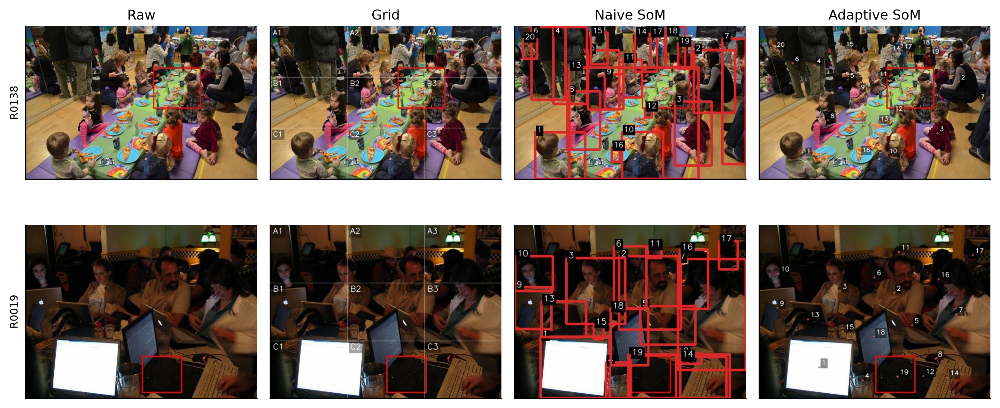
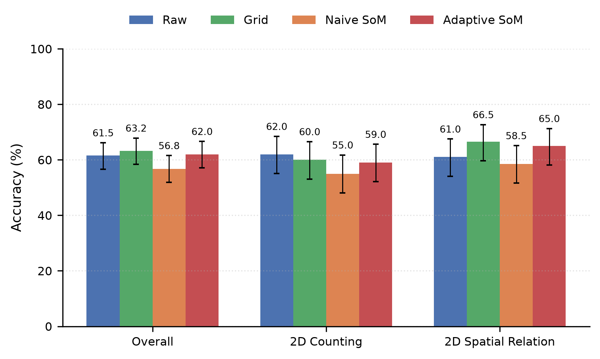
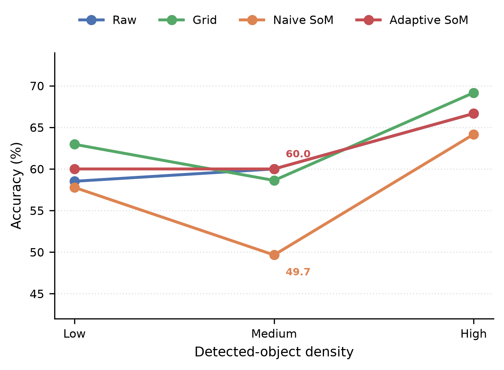

# When Does Visual Prompting Help or Hurt Edge MLLMs?

[](https://github.com/LeiPan-JLU/adaptive-visual-prompting-mllm)
[](paper/main.pdf)
[](requirements.txt)

Training-free visual prompting for small multimodal models, evaluated on a fixed
400-question CV-Bench 2D subset with **Qwen2-VL-2B-Instruct** on an 8 GB laptop GPU.



## What this project tests

Set-of-Mark (SoM) prompting is usually applied with large proprietary models and
thick boxes. On a 2B edge model, the same overlay can hide the object boundary or
the gap between objects, which is exactly the evidence needed for counting and
spatial-relation questions. We compare four matched input conditions:

- **Raw**: original image.
- **Grid**: 3x3 coordinate grid with A1-C3 labels.
- **Naive SoM**: fixed 3 px boxes and opaque number tags from YOLOv8n proposals.
- **Adaptive SoM**: density-aware rendering. Low density uses translucent boxes;
  medium density uses 1 px outlines with compact tags; high density uses centre
  dots and micro tags.

The density level is selected from the proposal count $N$ and the union box-area
ratio $\rho$; no model is trained or fine-tuned. See `docs/method.md` for the
algorithm and `paper/main.tex` for the full write-up.

## Results

Tested on 200 Count and 200 Relation questions (seed 42), greedy decoding, the
same question and image for every condition. Accuracy is reported in percent.

| Method | Overall | Count | Relation | Latency (s/img) |
|---|---:|---:|---:|---:|
| Raw | 61.5 | **62.0** | 61.0 | 0.31 |
| Grid | **63.2** | 60.0 | **66.5** | 0.31 |
| Naive SoM | 56.8 | 55.0 | 58.5 | 0.32 |
| Adaptive SoM | 62.0 | 59.0 | 65.0 | 0.32 |

**What the numbers say.** Fixed naive SoM significantly degrades overall accuracy
relative to the raw image (61.5 -> 56.8, McNemar $p=0.016$). Adaptive SoM recovers
most of that loss (62.0) and is significantly better than naive SoM
($p=0.0038$), but it does **not** beat the raw image ($p=0.864$) or the simple
Grid ($p=0.45$). The largest recovery is in the medium-density bucket
(60.0 vs 49.7 for naive SoM, $p=0.0015$). This is a boundary result: density-aware
marks are useful as a safeguard against over-annotation, not a universal win over
a coordinate grid.





## Repository layout

```text
src/data_prep.py           CV-Bench 2D parquet -> fixed 400-question subset
src/visual_prompter.py     YOLOv8n proposals + four renderers + preview
src/run_eval.py            Qwen2-VL-2B inference, resume, parsing, JSONL logs
src/analyze_and_plot.py    Wilson CIs, McNemar tests, summary.json, figures
data/eval_subset.jsonl     the fixed questions (images are downloaded/generated)
data/density_meta.jsonl    N, rho, density level for each image
results/summary.json       all paper numbers
results/preds_*.jsonl      per-question outputs for each condition
figures/                   300 dpi PDF/PNG figures
paper/                     arXiv-style LaTeX source and compiled PDF
```

## Reproduce

Python 3.13 was used locally; a CUDA 12.8 PyTorch build is required for the RTX
5060 (Blackwell) GPU.

```bash
python -m venv .venv
# Windows: .venv\Scripts\activate
pip install torch torchvision --index-url https://download.pytorch.org/whl/cu128
pip install -r requirements.txt
```

Download the Qwen2-VL-2B-Instruct weights (ModelScope is fast from mainland China):

```bash
pip install modelscope
python - <<'PY'
from modelscope import snapshot_download
snapshot_download("Qwen/Qwen2-VL-2B-Instruct",
                  local_dir="models/Qwen2-VL-2B-Instruct")
PY
```

Download the CV-Bench 2D parquet (185 MB) and put it at
`data/raw/test_2d.parquet`:

```text
https://modelscope.cn/api/v1/datasets/comefly/cvbench/repo?Revision=master&FilePath=test_2d.parquet
```

Then run the pipeline:

```bash
python src/data_prep.py                       # 400 questions + images
python src/visual_prompter.py --limit 5       # inspect figures/preview_5_samples.png
python src/visual_prompter.py                 # all 400 images, four conditions
python src/run_eval.py --mode all             # ~1,600 inferences; resumable
python src/analyze_and_plot.py                # summary.json + figures
```

`run_eval.py` appends each prediction immediately and skips completed ids on
restart. The model is loaded in float16 with `min_pixels=256*28*28` and
`max_pixels=512*28*28`; peak allocated memory in our run was about 4.4 GB.

## Citation

```bibtex
@misc{pan2026adaptive,
  author = {Pan, Lei},
  title  = {Density-Aware Adaptive Visual Prompting for Counting and Spatial Reasoning in Edge Multimodal Large Language Models},
  year   = {2026},
  url    = {https://github.com/LeiPan-JLU/adaptive-visual-prompting-mllm}
}
```

## License

MIT License, Copyright (c) 2026 Lei Pan. CV-Bench, Qwen2-VL, and YOLOv8 retain
their original licenses; the raw images and model weights are not redistributed.
